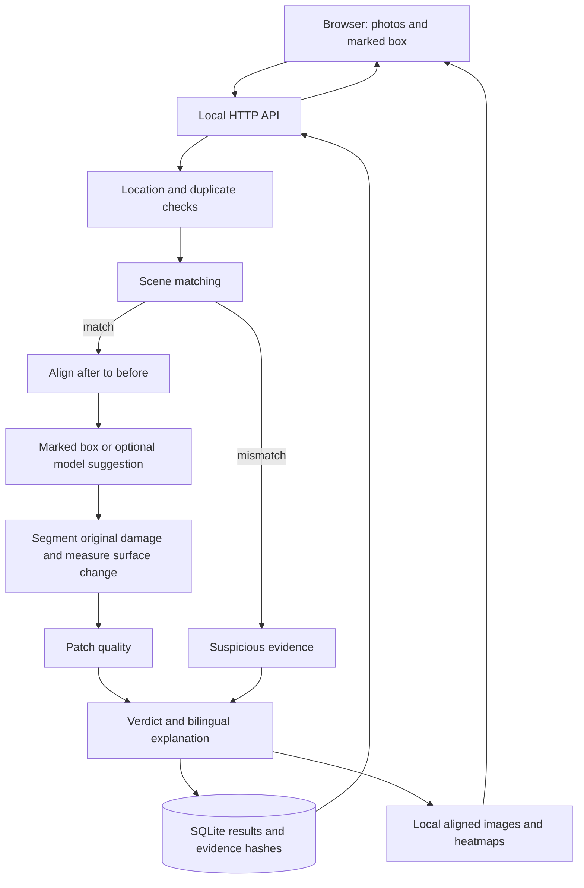

# FixCheck

**Stop paying for fake repairs.**

FixCheck compares before and after pothole photos to verify whether a reported repair actually happened. It runs locally, checks evidence before measuring damage, and returns a verdict with a repaired percentage, reasons, and English/Kannada explanations.

## What it does

- Run seven demo cases (five simulated and two real-photo examples) or upload your own before/after photos and mark the pothole with a box. Large JPEG/PNG photos are resized for processing, and phone EXIF orientation is respected.
- Check GPS distance, reused evidence, and whether both photos show the same scene.
- Align the photos, measure changes within the original damage, and assess patch quality.
- Show an image comparison and a repair heatmap, with a persistent local results ledger.
- Optionally suggest a pothole box from local model weights. A marked box works without model weights or external services.

The model suggests; the measurement verifies. The current scope is potholes; an absent GPS tag is recorded as skipped.

## How verdicts are decided

Rules run in the order below. The thresholds live in `backend/pipeline/config.py`.

| Priority | Condition | Verdict |
|---|---|---|
| 1 | Location, duplicate, or scene check fails | `SUSPICIOUS` |
| 2 | No reliable damage measurement inside the marked box | `NEEDS_REVIEW` |
| 3 | At least 85% repaired and patch quality does not fail | `FIXED` |
| 4 | At least 85% repaired but patch quality fails | `PARTIAL` |
| 5 | At least 25% and less than 85% repaired | `PARTIAL` |
| 6 | Less than 25% repaired | `NOT_FIXED` |

GPS passes at up to 30 m, warns up to 75 m, and fails above 75 m. Scene matching uses feature correspondences and a geometric consistency check. A failed scene check stops scoring. A perceptual hash checks for reused photos; demo cases only see earlier numbered demo complaints plus existing real uploads.

## Architecture



## Quick start

Use Python 3.12 and a recent Node.js release with npm. Run the following from the repository root. Initial dependency setup requires internet access; verification with a marked box runs locally afterward.

```bash
python3 -m venv .venv
source .venv/bin/activate
python -m pip install -r requirements.txt
```

In the prepared development environment, use `source ~/hack/.venv/bin/activate` instead; dependencies are already installed there.

Start the backend in one terminal, from the repository root:

```bash
source .venv/bin/activate
FIXCHECK_MOCK_SEG=1 python -m uvicorn backend.app.main:app --reload --port 8000
```

Use the prepared environment's activation path in that terminal if applicable. `FIXCHECK_MOCK_SEG=1` disables optional model suggestions; damage measurement remains active. For suggestions, omit that variable and set `FIXCHECK_WEIGHTS` to an existing local segmentation weights file.

Start the frontend in a second terminal:

```bash
cd frontend
npm ci
npm run dev -- --host 127.0.0.1 --port 5173
```

Open **http://localhost:5173**. Select a demo or upload two photos, enter a complaint ID, draw the pothole box, and select **Verify repair**. The frontend defaults to **http://localhost:8000**; set `VITE_API_URL` before starting it to use another API address. `VITE_MOCK=1` explicitly previews fixture results rather than running verification.

Check the running backend:

```bash
curl --fail http://localhost:8000/api/health
bash scripts/smoke.sh
```

Unreadable image files return HTTP 400 with a clear JPEG/PNG upload message. Missing or invalid marked boxes return HTTP 422.

The local database is `data/fixcheck.db`; generated evidence is under `data/runs/`. Both are ignored by version control. Demo photos are served under `/demo-files/`, generated evidence under `/files/`, and results under `/api/results`. Download an evidence report at `/api/results/{id}/report.pdf`; the report includes English and notes when Kannada cannot be rendered with the available PDF fonts.

## Reproduce the demo and evaluation

From the repository root, with the Python environment active:

```bash
python scripts/make_demo_pairs.py --raw data/raw --out data/demo --mask-mode auto
python scripts/eval.py
pytest backend -q
node --test frontend/tests/api.test.mjs
(cd frontend && npm run build)
```

Photo boxes come from `data/raw/rois.json`. Generation uses measured damage when available and warns when it falls back to an ellipse. Inspect `data/demo/_preview.jpg` after regeneration. Evaluation writes [docs/RESULTS.md](docs/RESULTS.md), with generated evidence under `data/runs/eval/`.

The recorded evaluation of **120 simulated repair pairs** matched the intended verdict on **120/120 pairs (100.0%)**, with an average verification time of **302.0 ms**. These figures measure synthetic consistency, not real-world repair accuracy or full upload latency. Thresholds were tuned on these simulated pairs; this is not an independent held-out evaluation. The five simulated demo cases cover full repair, partial repair, no repair, wrong location, and reused evidence. Two additional real-photo examples show an object removed from a marked area and a photo of a different spot; they illustrate evidence verification beyond the pothole examples.

## Demo honesty and photo credit

**Cases 01–05 have simulated after-photos.** Repairs are generated by inpainting and adding road texture, followed by small perspective and brightness changes. They are not photographs of actual completed repairs. Their metadata includes `simulated: true`, and the interface labels simulated examples. Cases 06–07, titled “Real photo”, use genuine supplied photos with `simulated: false` and no GPS; no repair is synthesized for those cases. Evaluation pairs are simulated too; arbitrary real uploads can require official review.

Source photos for cases 01–05: **Kenneth Allen, geograph.org.uk, CC BY-SA 2.0**, via Wikimedia Commons. Source photos and derived demo images retain that attribution and their image license. The two real-photo pairs use separately supplied local photos. Original phone files remain local; only re-encoded demo images are included. Regeneration refreshes real pairs when `data/real/` is available and otherwise retains existing real demo copies. The software license is separate.

## Roadmap and contributing

Next steps include more languages, capture-time location evidence, garbage verification, harder scene matching, contractor summaries, report improvements, container setup, and offline mobile support. See [eight starter issues](docs/ISSUES.md) and [CONTRIBUTING.md](CONTRIBUTING.md).

Software is licensed under **AGPL-3.0**; see [LICENSE](LICENSE).
