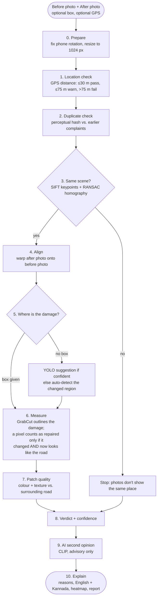
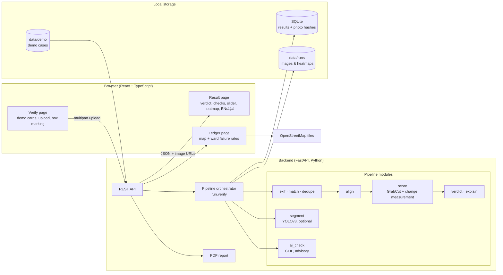
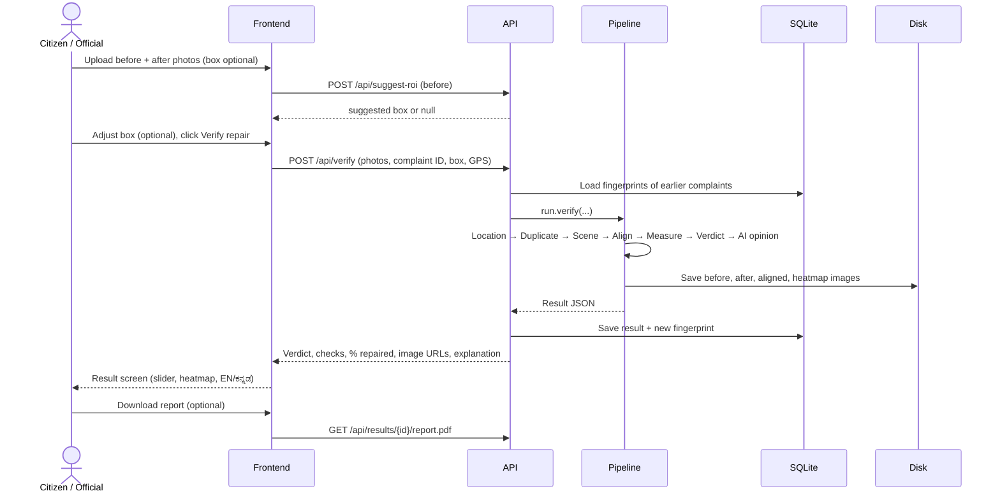

# Sabooth (ಸಾಬೀತು, Kannada for "proof")

**Stop paying for fake repairs.**

Sabooth checks whether a reported civic repair actually happened. Give it the **before** photo of a complaint and the **after** photo submitted as proof, and in well under a second it tells you whether the photos show the same place, whether the after photo was already used for another complaint, and how much of the original damage is really gone. Every verdict comes with evidence: a heatmap, plain-language reasons in English and Kannada, and a downloadable report.

It is free and open source, and runs entirely on a laptop. No paid APIs or cloud services are involved.

> Built for **HacktoberFest HackDay'26** (ECell × AWS Student Builder Group, RV University), Problem Statement 4 (AI/ML): *Proof of Fix: Was It Actually Repaired?*

---

## Contents

1. [The problem](#1-the-problem)
2. [Our idea](#2-our-idea)
3. [What Sabooth does](#3-what-sabooth-does)
4. [How it works: the verification pipeline](#4-how-it-works-the-verification-pipeline)
5. [System architecture](#5-system-architecture)
6. [Request flow](#6-request-flow)
7. [How verdicts are decided](#7-how-verdicts-are-decided)
8. [Why AI suggests and measurement decides](#8-why-ai-suggests-and-measurement-decides)
9. [Tech stack](#9-tech-stack)
10. [Results](#10-results)
11. [Impact](#11-impact)
12. [How Sabooth compares with existing solutions](#12-how-sabooth-compares-with-existing-solutions)
13. [Quick start](#13-quick-start)
14. [API reference](#14-api-reference)
15. [Project structure](#15-project-structure)
16. [Reproduce the demo and evaluation](#16-reproduce-the-demo-and-evaluation)
17. [Demo honesty and photo credit](#17-demo-honesty-and-photo-credit)
18. [Limitations](#18-limitations)
19. [Roadmap and contributing](#19-roadmap-and-contributing)
20. [License](#20-license)

---

## 1. The problem

Bengaluru residents can report potholes and garbage through civic apps. A complaint is usually closed when someone uploads one **"after" photo** as proof. **Nobody systematically checks that photo.**

That leaves gaps that are easy to exploit and hard to catch by hand:

| What goes wrong | What it looks like |
|---|---|
| **Wrong location** | The "after" photo shows a clean road somewhere else |
| **Reused evidence** | One photo of a fixed road is used to close several complaints |
| **Partial repair** | Half the pothole is filled and the complaint is still marked resolved |
| **No repair at all** | The same pothole, photographed again from a different angle |

The consequences: public money pays for work that wasn't done, hazards come back, and citizens stop trusting the complaint system. Officials handle thousands of complaints, so inspecting every repair on site isn't possible.

**The gap:** complaint systems already *collect* after photos. What's missing is *verifying* them, reliably and at scale.

## 2. Our idea

Treat every "resolved" complaint like evidence in a case, and check it before it's accepted:

1. **Is it the same place?** Compare GPS, then compare the actual scene.
2. **Is the photo original?** Look for the same image already used for another complaint.
3. **How much was actually fixed?** Align the two photos and measure how much of the original damage now looks like normal road.
4. **Explain the result.** Give a clear verdict, with the evidence a citizen or official can check.

> **The model suggests. The measurement verifies.**
> AI helps locate the problem and gives an independent second opinion, but the verdict comes from transparent, explainable measurement.

## 3. What Sabooth does

- **Five verdicts:** `FIXED`, `PARTIAL`, `NOT_FIXED`, `SUSPICIOUS`, `NEEDS_REVIEW`, each with a confidence score.
- **Four evidence checks:** location (GPS), duplicate photo, same scene, and patch quality.
- **% repaired:** how much of the original damage area is actually fixed.
- **Visual evidence:** a before/after comparison slider and a heatmap (green = repaired, red = still broken). When photos don't match, both originals are shown side by side.
- **Plain-language explanations** in **English and Kannada**.
- **AI second opinion:** a CLIP vision model independently judges "repaired / partly repaired / not repaired" and flags disagreements for human review. It never changes the verdict.
- **Optional marking:** draw a box around the problem for precision, or skip it and Sabooth finds the changed area itself.
- **Public ledger:** a map and table of every verification, with failure rates per ward.
- **PDF evidence report** for each result, for disputes and records.
- **Six built-in demo cases** (keys `1`–`6`) covering every verdict path, including one pair of real camera photos.

## 4. How it works: the verification pipeline



### Step by step

| Step | What happens | Technique |
|---|---|---|
| **0. Prepare** | Respect phone EXIF orientation; resize so the longest side is 1024 px | Pillow, OpenCV |
| **1. Location** | Distance between the GPS of the two photos (or typed coordinates) | Haversine formula |
| **2. Duplicate** | Fingerprint the after photo and compare with every earlier complaint | Perceptual hash (pHash), Hamming distance ≤ 6 |
| **3. Same scene** | Find thousands of distinctive points (kerbs, cracks, markings) in both photos and match them geometrically | SIFT features, Lowe ratio test, RANSAC homography |
| **4. Align** | Warp the after photo so it lines up pixel-for-pixel with the before photo | Perspective warp |
| **5. Locate** | Use the marked box; otherwise a confident model suggestion; otherwise the largest region that changed between the aligned photos | YOLOv8 (optional), change detection |
| **6. Measure** | Outline the exact damage inside the box, then decide pixel by pixel whether it is repaired. Lighting is matched first using the surrounding road, so a brighter photo doesn't count as a repair | GrabCut segmentation, Lab colour + texture analysis |
| **7. Quality** | Compare the patch's brightness and texture with the road around it | Laplacian texture, colour statistics |
| **8. Verdict** | Apply the rules in [section 7](#7-how-verdicts-are-decided) and compute confidence | Rule engine |
| **9. AI opinion** | Crop the area from both photos and ask CLIP "pothole or repaired road?" | CLIP zero-shot (ViT-B/32) |
| **10. Explain** | Reasons, bilingual text, heatmap, aligned image, PDF | Templates, ReportLab |

A **failed same-scene check stops measurement**. If the photos don't show the same place, there's nothing honest to measure.

## 5. System architecture



**Design choices**

- **Local-first:** all analysis runs on the machine; photos never leave it. Only map tiles are fetched from OpenStreetMap.
- **Evidence before measurement:** fraud checks run first and short-circuit scoring.
- **One place for thresholds:** every tunable value lives in `backend/pipeline/config.py`.
- **AI is optional:** without model weights, everything except the box suggestion and the second opinion still works (`FIXCHECK_MOCK_SEG=1`, `FIXCHECK_NO_AI=1`).

## 6. Request flow



## 7. How verdicts are decided

Rules run **in this order**; the first match wins.

| Priority | Condition | Verdict |
|---|---|---|
| 1 | Location, duplicate or scene check **fails** | `SUSPICIOUS` |
| 2 | No clear damage found in the before photo | `NEEDS_REVIEW` |
| 3 | ≥ 85% repaired and patch quality is not poor | `FIXED` |
| 4 | ≥ 85% repaired but patch quality is poor | `PARTIAL` |
| 5 | 25% – 85% repaired | `PARTIAL` |
| 6 | < 25% repaired | `NOT_FIXED` |

**Key thresholds** (`backend/pipeline/config.py`)

| Check | Pass rule |
|---|---|
| Location | ≤ 30 m pass · 30–75 m warning · > 75 m fail |
| Same scene | ≥ 25 RANSAC inliers **and** ≥ 25% inlier ratio, with a sane homography |
| Duplicate | pHash Hamming distance ≤ 6 to any earlier complaint = reused |
| Damage present | segmented area ≥ 5% of the box and clearly different from the road (colour **or** texture) |
| Repaired pixel | changed since the before photo **and** now within the road's normal colour range |

**Confidence** starts high and is reduced for missing or borderline GPS, a % close to a threshold, or uncertain patch quality. It is scaled by how strongly the scenes match.

## 8. Why AI suggests and measurement decides

We tested this directly:

- **Public pothole-segmentation models (YOLOv8 n/s/m) failed on real street photos.** They marked grass, puddles or shadows, or found nothing.
- **No public dataset of before/after repair pairs exists**, so a "was it repaired?" classifier can't be trained honestly.
- **Verdicts can affect payments**, so they must be explainable: "photos taken 140 m apart" or "42% of the pothole area is still damaged", not "the model said so".

So AI is used where it helps, without being the final judge:

| AI component | Role | Can it change the verdict? |
|---|---|---|
| **YOLOv8 pothole segmentation** | Suggests a box when confident (≥ 0.5) | No; the user can adjust it, and measurement decides |
| **GrabCut** (learns colour models per photo) | Outlines the exact damage inside the box | Part of the measurement |
| **CLIP ViT-B/32** (zero-shot) | Independent second opinion: repaired / partly / not repaired | **No.** Disagreement is shown and flagged for human review |

**What we found about CLIP:** on real pothole photos with simulated repairs, it reliably tells a full repair from an untouched pothole, but it misses partial repairs, which is why it advises and doesn't measure. For the real-camera demo case, where an object stands in for a pothole, it reports "no pothole recognised". That's a recognition limit, not proof of no damage.

## 9. Tech stack

| Layer | Technology | Used for |
|---|---|---|
| Language | **Python 3.12** | Pipeline and API |
| Computer vision | **OpenCV** | SIFT matching, RANSAC homography, alignment, GrabCut, colour/texture analysis |
| AI models | **Ultralytics YOLOv8** (PyTorch) · **CLIP** (Hugging Face Transformers) | Optional box suggestion · advisory second opinion |
| Image utilities | **Pillow**, **NumPy**, **imagehash** | EXIF/GPS, arrays, perceptual hashing |
| API | **FastAPI** + **Uvicorn** | REST endpoints, static evidence files |
| Storage | **SQLite** | Results and photo fingerprints |
| Reports | **ReportLab** | One-page PDF evidence report |
| Frontend | **React** + **TypeScript** + **Vite** | Web app |
| UI | **Tailwind CSS**, **Framer Motion**, **react-compare-slider**, **Lucide** icons | Styling, animation, before/after slider |
| Maps | **Leaflet** + **OpenStreetMap** | Ledger map (free, no API key) |
| Testing | **pytest** · Node test runner · **Playwright** | Backend, frontend and browser interaction tests |
| License | **AGPL-3.0** | Open source |

**Cost: ₹0.** Everything is open source, runs on a standard laptop (developed on an Apple M4 MacBook Air), and uses no paid APIs.

## 10. Results

| Metric | Value |
|---|---|
| Simulated evaluation | **120 / 120** verdicts correct across 8 real pothole photos (fixed, partial, not fixed, wrong location, reused photo; 3 variations each) |
| Average verification time | **~0.3 s** per check on a laptop |
| Demo cases | **6 / 6** return the expected verdict |
| Automated tests | **130+ backend tests**, plus frontend unit and Playwright browser tests |

**Read these numbers honestly:** the evaluation pairs are **simulated repairs**, and thresholds were tuned on them, so this measures consistency rather than real-world accuracy. Real-world accuracy will be lower. That's why every result shows its evidence, and disagreements or low-confidence cases go to a human. Full details are in [docs/RESULTS.md](docs/RESULTS.md).

## 11. Impact

| Who | What changes |
|---|---|
| **Citizens** | Proof, not promises: they can see whether their complaint was really fixed and challenge a false closure with evidence |
| **Civic bodies and inspectors** | Instead of visiting thousands of sites, inspectors go only to flagged cases |
| **Taxpayers** | Payment for incomplete or fake repairs gets caught before it's made |
| **Contractors** | Honest work is verified automatically; repeated failures become visible on the ledger |

**Why it can scale:**

- **Plugs into existing systems.** Any complaint app can call one API endpoint with the photos it already collects.
- **Free and open source,** so any city, ward or residents' association can pilot it at no cost.
- **Runs offline on modest hardware,** with no cloud bills and no photos leaving the machine.
- **Extends beyond potholes.** "Repaired" means "the area now looks like its surroundings", which also fits garbage cleanups, broken footpaths and drains.

## 12. How Sabooth compares with existing solutions

| | Civic complaint apps (e.g. BBMP apps) | Citizen reporting platforms (e.g. NammaKasa) | AI road-scanning services | **Sabooth** |
|---|---|---|---|---|
| Report and track issues | ✅ | ✅ | — | Works alongside them |
| Collect "after" photos | Some | ✅ | — | ✅ |
| Verify the after photo is the **same place** | Manual | Manual | — | ✅ Automatic |
| Detect **reused or fake** photos | — | — | — | ✅ |
| Measure **how much** was fixed | — | — | Detection only | ✅ |
| Explainable verdict + heatmap | — | — | Partial | ✅ |
| Free and open source | Free, closed | Free | Paid | ✅ |

**Sabooth isn't a replacement for these platforms.** It's the missing verification layer they can plug in.

## 13. Quick start

**Requirements:** Python 3.12, a recent Node.js with npm. Initial setup needs internet; verification then runs locally.

```bash
# 1. Backend dependencies (from the repository root)
python3 -m venv .venv
source .venv/bin/activate
python -m pip install -r requirements.txt
```

```bash
# 2. Start the backend (terminal 1, repository root)
source .venv/bin/activate
FIXCHECK_MOCK_SEG=1 python -m uvicorn backend.app.main:app --reload --port 8000
```

- `FIXCHECK_MOCK_SEG=1` turns off the optional YOLO suggestion. Measurement still works. To enable suggestions, omit it and set `FIXCHECK_WEIGHTS=/path/to/pothole-seg.pt`.
- `FIXCHECK_NO_AI=1` turns off the CLIP second opinion.

```bash
# 3. Start the frontend (terminal 2)
cd frontend
npm ci
npm run dev -- --host 127.0.0.1 --port 5173
```

Open **http://localhost:5173**.

- Press **1–6** to run a demo case, **H** to toggle the heatmap, **K** for Kannada.
- Or upload a before and after photo, enter a complaint ID, optionally mark the problem area, and click **Verify repair**.
- `VITE_API_URL` sets a different API address. `VITE_MOCK=1` previews fixture results without a backend.

```bash
# 4. Check it's working
curl --fail http://localhost:8000/api/health
bash scripts/smoke.sh
```

## 14. API reference

Base URL: `http://localhost:8000`

| Method | Path | Purpose |
|---|---|---|
| `GET` | `/api/health` | Health check (model and mode status) |
| `GET` | `/api/demo` | List demo cases |
| `POST` | `/api/demo/{case_id}/verify` | Run a demo case |
| `POST` | `/api/suggest-roi` | Suggest a damage box for a before photo (multipart `before`) |
| `POST` | `/api/verify` | Verify a repair (multipart: `before`, `after`, `complaint_id`, optional `roi`, optional `before_lat/lon`, `after_lat/lon`) |
| `GET` | `/api/results` | All results, newest first (powers the ledger) |
| `GET` | `/api/results/{id}` | One result |
| `GET` | `/api/results/{id}/report.pdf` | PDF evidence report |

**Example result (shortened)**

```json
{
  "verdict": "PARTIAL",
  "confidence": 0.81,
  "percent_resolved": 50.2,
  "reasons": ["Only 50% of the original pothole area is repaired",
              "Same location confirmed (2 m apart, 1,240 matching points)"],
  "checks": {
    "location":  {"status": "pass", "distance_m": 2.1},
    "duplicate": {"status": "pass"},
    "scene":     {"status": "pass", "inliers": 1240, "inlier_ratio": 0.62},
    "quality":   {"status": "pass", "score": 0.71}
  },
  "ai_opinion": {"status": "ok", "ai_says": "not repaired", "agrees": false},
  "explanation": {"en": "Partial repair. Only 50.2% of the original pothole has been fixed. Re-inspection needed.",
                  "kn": "ಭಾಗಶಃ ದುರಸ್ತಿ. ..."},
  "images": {"before": "/files/…/before.jpg", "after_aligned": "/files/…/after_aligned.jpg",
             "heatmap": "/files/…/heatmap.jpg"}
}
```

Errors: unreadable images return **400**; an invalid box returns **422**.

## 15. Project structure

```
├── backend/
│   ├── app/
│   │   ├── main.py          # FastAPI routes, demo registration, static files
│   │   ├── store.py         # SQLite: results + photo fingerprints
│   │   └── report.py        # PDF evidence report
│   ├── pipeline/
│   │   ├── run.py           # Orchestrates the full verification
│   │   ├── exif.py          # GPS + orientation from photo metadata
│   │   ├── match.py         # GPS distance + SIFT/RANSAC scene matching
│   │   ├── align.py         # Resize + perspective alignment
│   │   ├── dedupe.py        # Perceptual hashing for reused photos
│   │   ├── segment.py       # Optional YOLOv8 box suggestion
│   │   ├── score.py         # GrabCut damage outline, repair measurement, quality, heatmap
│   │   ├── verdict.py       # Verdict rules + confidence
│   │   ├── explain.py       # English + Kannada explanations
│   │   ├── ai_check.py      # CLIP advisory second opinion
│   │   ├── config.py        # All thresholds in one place
│   │   └── types.py         # Shared data types
│   └── tests/               # pytest suite
├── frontend/
│   ├── src/                 # React app: Verify, Result, Ledger pages
│   └── tests/               # Unit + Playwright browser tests
├── scripts/
│   ├── make_demo_pairs.py   # Builds simulated demo cases
│   ├── eval.py              # Simulated evaluation → docs/RESULTS.md
│   ├── check_pair.py        # Verify any photo pair from the command line
│   ├── try_defect.py        # Visualise damage measurement on photos
│   ├── try_clip.py          # CLIP experiment
│   └── smoke.sh             # Runs all demo cases against the API
├── data/
│   ├── raw/                 # Source photos + marked boxes (rois.json)
│   └── demo/                # Demo cases (before, after, meta.json)
└── docs/
    ├── RESULTS.md           # Evaluation results
    └── ISSUES.md            # Starter issues for contributors
```

## 16. Reproduce the demo and evaluation

With the Python environment active, from the repository root:

```bash
python scripts/eval.py                        # simulated evaluation → docs/RESULTS.md
pytest backend -q                             # backend tests
node --test frontend/tests/api.test.mjs       # frontend unit tests
(cd frontend && npm run build)                # production build
python scripts/check_pair.py BEFORE.jpg AFTER.jpg --roi 0.4,0.4,0.6,0.6   # any real pair
```

`scripts/make_demo_pairs.py` can regenerate simulated demo cases from `data/raw/`. The committed demo images were refined by hand-tuned patching, so regenerating will change their appearance.

## 17. Demo honesty and photo credit

- **Cases 01–05 use simulated after photos.** The repairs are created by blending a patch of nearby road texture over the damage (full, half, or none), followed by a small change of camera angle and brightness. Case 04 uses a photo of a different road, and case 05 reuses case 01's after photo. These aren't photographs of real completed repairs. They're marked `simulated: true`, and the app labels them **"Simulated repair (demo)"**.
- **Case 06 uses real camera photos** taken at the venue, with an object standing in for a pothole. It's marked `simulated: false`. The images were re-encoded with location metadata removed.
- The evaluation pairs are simulated too. Arbitrary real uploads may need official review.

**Photo credit:** source photos for cases 01–05 are by **Kenneth Allen, geograph.org.uk, CC BY-SA 2.0** (via Wikimedia Commons). Derived demo images keep that attribution and licence. The software licence is separate.

## 18. Limitations

- Accuracy is measured on **simulated** repairs; real-world accuracy needs field data.
- Scene matching needs some recognisable surroundings. Extreme close-ups or very different viewpoints may fail and be flagged rather than measured.
- Heavy shadows, rain or night photos can affect the measurement.
- GPS from phone photos can be stripped or inaccurate. Missing GPS is recorded as "skipped", not treated as fraud.
- Explanations currently use pothole wording. Garbage support uses the same pipeline but isn't worded or tuned yet.
- The CLIP second opinion doesn't detect partial repairs.

## 19. Roadmap and contributing

- **Garbage cleanup verification** with its own wording and tuning
- **Capture inside the app with signed GPS and timestamp** to prevent fake uploads at the source
- **More Indian languages** (Hindi, Tamil, Telugu)
- **Contractor scorecards** and ward-level trends on the ledger
- **Real field dataset** of before/after pairs, which enables training a dedicated repair-verification model
- **Mobile/PWA** and **Docker** setup

Starter issues for Hacktoberfest contributors are in [docs/ISSUES.md](docs/ISSUES.md). Read [CONTRIBUTING.md](CONTRIBUTING.md) before opening a pull request.

## 20. License

Software: **AGPL-3.0** (see [LICENSE](LICENSE)). Demo photos: **CC BY-SA 2.0**, as credited above.

---

**Sabooth: fixing roads is politics. Proving whether they were fixed shouldn't be.**
